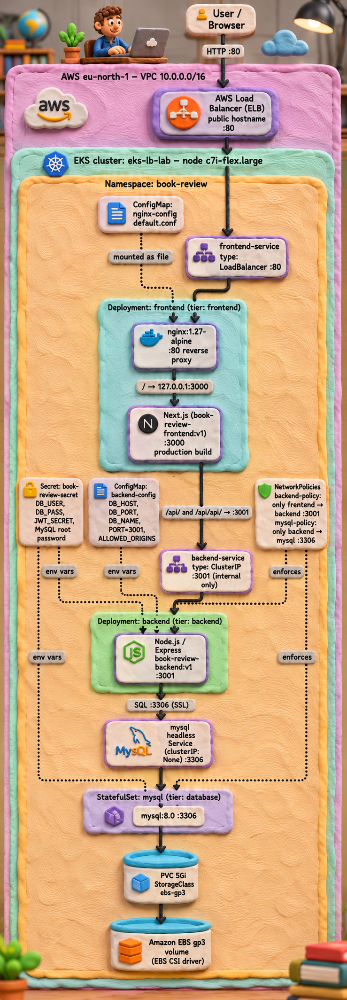

# Book Review App on Kubernetes (Amazon EKS)

A three-tier web application (**Next.js frontend → Node.js/Express API → MySQL**) deployed to Amazon EKS with plain Kubernetes YAML manifests.

Built for **Week 12, Assignment 10** of the DevOps Micro Internship (DMI) Cohort 3 by Pravin Mishra.
Application source: [pravinmishraaws/book-review-app](https://github.com/pravinmishraaws/book-review-app)

---

## Architecture



| Tier | Kubernetes objects | Image | Port | Exposure |
|---|---|---|---|---|
| Presentation | Deployment `frontend` (2 replicas): Next.js + Nginx sidecar | `ginnyibe/book-review-frontend:v1`, `nginx:1.27-alpine` | 3000 / 80 | `frontend-service`, **LoadBalancer** (AWS ELB) |
| Application | Deployment `backend` (1 replica) | `ginnyibe/book-review-backend:v1` | 3001 | `backend-service`, **ClusterIP** (internal only) |
| Data | StatefulSet `mysql` + 5Gi PVC on `ebs-gp3` | `mysql:8.0` | 3306 | `mysql`, **headless** Service (internal only) |

**Request flow**

```
Browser ──HTTP:80──▶ AWS ELB ──▶ frontend-service ──▶ Nginx (:80)
                                                        ├── /          ──▶ Next.js 127.0.0.1:3000
                                                        └── /api/      ──▶ backend-service:3001 ──▶ mysql:3306 ──▶ EBS gp3 volume
```

- The frontend is built with `NEXT_PUBLIC_API_URL=/api`, a **relative** path. The browser calls the same host, and Nginx sends the request on to the backend, so no Kubernetes Service name ever reaches the browser.
- Nginx also handles `/api/api/`, because the app's home page appends `/api/books` to the API URL.
- **NetworkPolicies:** only `tier: frontend` Pods may reach the backend on 3001, and only `tier: backend` Pods may reach MySQL on 3306. All other ingress to those tiers is denied.

---

## Repository contents

| File | Purpose |
|---|---|
| `01-backend-configmap.yaml` | `backend-config`: `PORT`, `DB_HOST`, `DB_PORT`, `DB_NAME`, `ALLOWED_ORIGINS` (non-sensitive) |
| `02-secret.example.yaml` | `book-review-secret` **template with placeholders only**. The real Secret is never committed. |
| `03-storageclass.yaml` | `ebs-gp3` StorageClass (EBS CSI driver, `WaitForFirstConsumer`) |
| `04-mysql.yaml` | Headless Service `mysql` + StatefulSet `mysql` with `volumeClaimTemplates` and a readiness probe |
| `05-backend-deployment.yaml` | Backend Deployment with readiness and liveness probes |
| `06-backend-service.yaml` | `backend-service`, ClusterIP on 3001 |
| `07-nginx-configmap.yaml` | `nginx-config`, the reverse-proxy `default.conf` |
| `08-frontend-deployment.yaml` | Frontend Deployment (Next.js + Nginx), with probes on both containers |
| `09-frontend-service.yaml` | `frontend-service`, LoadBalancer on port 80 |
| `10-network-policies.yaml` | `backend-policy` and `mysql-policy` |
| `docker/` | Production `Dockerfile.k8s` for the frontend, and the `.dockerignore` files used to build both images |
| `architecture.png` | Architecture diagram |

---

## Prerequisites

- An EKS cluster with `kubectl` access (mine: `eks-lb-lab`, eu-north-1, Kubernetes v1.37, one `c7i-flex.large` node, built with Terraform)
- The **Amazon EBS CSI driver** add-on, with an IRSA role that has `AmazonEBSCSIDriverPolicy`
- The **Amazon VPC CNI** add-on with `enableNetworkPolicy: "true"`, so the NetworkPolicies are enforced
- Docker and a Docker Hub account, if you rebuild the images

```bash
# EBS CSI driver (IRSA role + add-on)
eksctl create iamserviceaccount --name ebs-csi-controller-sa --namespace kube-system \
  --cluster eks-lb-lab --region eu-north-1 --role-name AmazonEKS_EBS_CSI_DriverRole --role-only \
  --attach-policy-arn arn:aws:iam::aws:policy/service-role/AmazonEBSCSIDriverPolicy --approve
aws eks create-addon --cluster-name eks-lb-lab --region eu-north-1 --addon-name aws-ebs-csi-driver \
  --service-account-role-arn "arn:aws:iam::<ACCOUNT_ID>:role/AmazonEKS_EBS_CSI_DriverRole"

# NetworkPolicy enforcement (use update-addon if vpc-cni is already a managed add-on)
aws eks create-addon --cluster-name eks-lb-lab --region eu-north-1 --addon-name vpc-cni \
  --configuration-values '{"enableNetworkPolicy":"true"}' --resolve-conflicts OVERWRITE
```

---

## Build the images (optional)

```bash
git clone https://github.com/pravinmishraaws/book-review-app.git && cd book-review-app
cp ../book-review-k8s/docker/backend.dockerignore      backend/.dockerignore
cp ../book-review-k8s/docker/frontend.dockerignore     frontend/.dockerignore
cp ../book-review-k8s/docker/frontend.Dockerfile.k8s   frontend/Dockerfile.k8s

docker build -t <dockerhub-user>/book-review-backend:v1 ./backend
docker build -f frontend/Dockerfile.k8s --build-arg NEXT_PUBLIC_API_URL=/api \
  -t <dockerhub-user>/book-review-frontend:v1 ./frontend
docker push <dockerhub-user>/book-review-backend:v1
docker push <dockerhub-user>/book-review-frontend:v1
```

> The upstream repo commits `backend/.env`. `backend.dockerignore` keeps it (and `node_modules`) out of the image.
> The upstream frontend Dockerfile runs `npm run dev`. `Dockerfile.k8s` runs a production `npm run build` and `npm start`.

If you use your own images, change the `image:` lines in `05-` and `08-`.

---

## Deploy

```bash
kubectl create namespace book-review
kubectl config set-context --current --namespace=book-review
```

**1. Create the real Secret outside Git.** The values are generated, so they never appear on screen:

```bash
mkdir -p ../secrets-local
cat > ../secrets-local/book-review-secret.yaml <<EOF
apiVersion: v1
kind: Secret
metadata:
  name: book-review-secret
  namespace: book-review
type: Opaque
stringData:
  MYSQL_ROOT_PASSWORD: "$(openssl rand -hex 16)"
  DB_USER: "bookreview"
  DB_PASS: "$(openssl rand -hex 16)"
  JWT_SECRET: "$(openssl rand -hex 32)"
EOF
chmod 600 ../secrets-local/book-review-secret.yaml
kubectl apply --server-side -f ../secrets-local/book-review-secret.yaml
```

`--server-side` avoids storing a plain-text copy of the values in the `last-applied-configuration` annotation.

**2. Apply the manifests in order:**

```bash
kubectl apply -f 01-backend-configmap.yaml
kubectl apply -f 03-storageclass.yaml
kubectl apply -f 04-mysql.yaml          && kubectl rollout status statefulset/mysql
kubectl apply -f 05-backend-deployment.yaml -f 06-backend-service.yaml
kubectl rollout status deployment/backend
kubectl apply -f 07-nginx-configmap.yaml -f 08-frontend-deployment.yaml
kubectl rollout status deployment/frontend
kubectl apply -f 09-frontend-service.yaml
kubectl apply -f 10-network-policies.yaml
```

**3. Point CORS at the LoadBalancer.** The hostname only exists after step 2:

```bash
LB_HOST=$(kubectl get svc frontend-service -o jsonpath='{.status.loadBalancer.ingress[0].hostname}')
sed -i "s|http://[^\"]*|http://$LB_HOST|" 01-backend-configmap.yaml
kubectl apply -f 01-backend-configmap.yaml
kubectl rollout restart deployment/backend
echo "http://$LB_HOST"
```

The `ALLOWED_ORIGINS` value committed here is the ELB hostname from my own deployment. Step 3 replaces it with yours.

---

## Verify

```bash
kubectl get all,pvc,networkpolicy
curl -sI "http://$LB_HOST/" | head -n 1                 # HTTP/1.1 200 OK
curl -s  "http://$LB_HOST/api/books" | head -c 200       # JSON list of books from MySQL
kubectl logs deployment/backend | head -7                # "connected successfully with SSL!", "Server running on port 3001"
```

**NetworkPolicy tests**

```bash
# allowed: frontend -> backend
kubectl exec deployment/frontend -c nginx -- wget -qO- --timeout=5 http://backend-service:3001/api/books | head -c 80

# denied: an unlabelled Pod -> backend and -> MySQL (expect curl exit code 28 = timed out)
kubectl run np-denied --restart=Never --image=curlimages/curl -- \
  sh -c 'curl -s -o /dev/null -w "HTTP %{http_code}\n" --max-time 5 http://backend-service:3001/api/books; echo "exit $?"'
kubectl run np-mysql --restart=Never --image=curlimages/curl -- \
  sh -c 'curl -s --connect-timeout 5 telnet://mysql:3306 </dev/null; echo "exit $?"'
kubectl wait --for=jsonpath='{.status.phase}'=Succeeded pod/np-denied pod/np-mysql --timeout=60s
kubectl logs np-denied; kubectl logs np-mysql; kubectl delete pod np-denied np-mysql
```

**User flow tested in the browser:** view the books → open a book → register → log in → post a review. The new user and review were confirmed in the `Users` and `Reviews` tables.

**Persistence:** a row written to MySQL survived `kubectl delete pod mysql-0`, because the StatefulSet reattached the same EBS-backed PVC.

---

## Issues found and fixed

| Issue | Fix |
|---|---|
| The backend defaults to port 5000 | `PORT=3001` in the ConfigMap |
| `backend/.env` is committed upstream and would have been copied into the image | `.dockerignore`, verified with `ls -la /app` in the image |
| The upstream frontend image runs in dev mode | Production `Dockerfile.k8s` |
| The home page requests `/api/api/books` | An extra Nginx `location /api/api/` rule |
| The PVC would stay `Pending` (only the in-tree `gp2` provisioner existed) | EBS CSI add-on with IRSA + the `ebs-gp3` StorageClass |
| NetworkPolicies weren't enforced (`--enable-network-policy=false`) | Created the `vpc-cni` managed add-on with `enableNetworkPolicy: true` |
| CORS blocked the browser until the ELB existed | Set `ALLOWED_ORIGINS` to the ELB URL and restarted the backend |

---

## Cleanup

Order matters: delete the LoadBalancer Service and the PVC **before** destroying the cluster. Otherwise the ELB and the EBS volume are left behind and keep costing money.

```bash
kubectl delete svc frontend-service -n book-review        # removes the AWS ELB
kubectl delete namespace book-review                      # removes workloads + PVC (EBS volume deleted: reclaimPolicy Delete)
eksctl delete iamserviceaccount --cluster eks-lb-lab --namespace kube-system --name ebs-csi-controller-sa
terraform destroy                                         # in the Terraform folder for the cluster
```

---

## Author

**Ginny Ibe**, DMI Cohort 3, Group 3

Thanks to Pravin Mishra and the DMI mentors.
